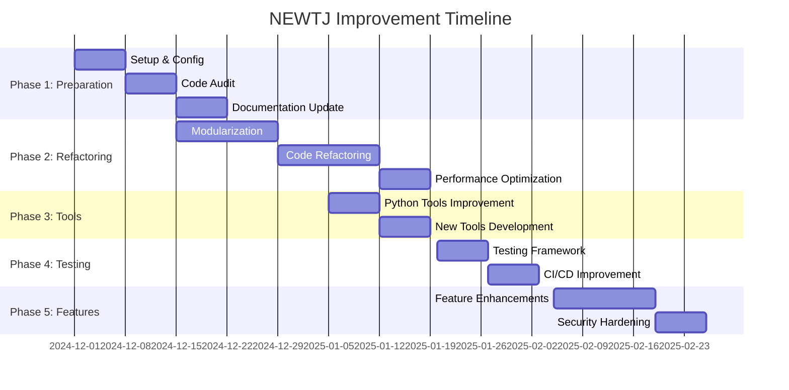

# 📋 แผนการแก้ไขและปรับปรุงสคริปต์ NEWTJ

## 📌 สรุปภาพรวม

**โปรเจค:** NEWTJ (TAYJAY SOFTMOVE) - Lua executor script สำหรับ Roblox
**ภาษาหลัก:** Lua (main.lua)
**เครื่องมือสนับสนุน:** Python 3 (tools/*.py)
**เวอร์ชันปัจจุบัน:** Phase 18.3 (TargetService lifecycle hardening)
**Source of Truth:** `main.lua` ใน branch `main` ของ repository `dailizer33-cloud/NEWTJ`

---

## 🎯 วัตถุประสงค์หลัก

1. **ปรับปรุงคุณภาพโค้ด** - ลด code duplication, เพิ่ม readability, ปรับโครงสร้างให้เป็นระเบียบ
2. **เพิ่มความเสถียร** - แก้ bug, ปรับปรุง error handling, ลด risk ของ anti-cheat detection
3. **ปรับปรุงประสิทธิภาพ** - Optimize performance, ลด resource usage, เพิ่ม FPS
4. **รักษาความเข้ากันได้** - ตรวจสอบว่า script ทำงานได้กับ Roblox version ปัจจุบัน
5. **อัตโนมัติการทำงาน** - ปรับปรุง GitHub Actions workflows ให้ทำงานได้อย่างราบรื่น

---

## 📂 โครงสร้างโปรเจค

```
NEWTJ/
├── main.lua                    # Main script (358KB, Source of Truth)
├── original.txt                # Snapshot จาก Phase 16
├── static-check.sh             # Structural validation script
├── README.md                   # Documentation
├── CHANGELOG.md                # ประวัติการเปลี่ยนแปลง
├── LICENSE.txt                 # License
├── Newtj.zip                   # Archive
├── phase16_mm2_billboard_fix.lua
├── phase17_esp_billboard_guard.diff
├── PHASE16.md
├── PHASE17.md
├── .github/
│   └── workflows/              # GitHub Actions (16 workflows)
│       ├── static-check.yml
│       ├── apply-skill-hybrid.yml
│       ├── apply-hybrid-movement.yml
│       ├── apply-vjoy-optimize.yml
│       ├── apply-warp-boss-event.yml
│       └── ...
├── tools/                      # Python automation tools
│   ├── apply_skill_hybrid.py
│   ├── apply_hybrid_movement.py
│   ├── apply_vjoy_optimize.py
│   ├── apply_warp_boss_event_skills.py
│   └── apply_vjoy_warp_collect.py
├── modules/
│   └── skill_hybrid.lua        # Hybrid Skill System module
├── patches/                    # Patch files (.diff)
│   ├── skill-hybrid-integrate.diff
│   ├── phase18_4_luau_syntax_fix.diff
│   ├── phase18_5_scope_fix.diff
│   └── phase19_warp_monster_exclusive.diff
└── docs/                       # Documentation
    ├── PHASE18_3.md
    ├── SKILL_HYBRID.md
    └── FIX-nil-Main.md
```

---

## 🔍 การวิเคราะห์สถานะปัจจุบัน

### ✅ สิ่งที่ทำงานได้ดี

1. **ระบบ Phase Management** - มีการจัดการ phase ที่ชัดเจน (16, 17, 18.2, 18.3)
2. **Static Check System** - `static-check.sh` ตรวจสอบ structural integrity ได้ดี
3. **Python Automation Tools** - มี tools สำหรับ apply patches อัตโนมัติ
4. **GitHub Actions** - มี workflows สำหรับ CI/CD
5. **Documentation** - มีเอกสารอธิบาย phase ต่างๆ
6. **Module System** - มี `modules/skill_hybrid.lua` แยกออกมา

### ⚠️ ปัญหาที่พบ

1. **Code Duplication** - มีโค้ดซ้ำใน tools ต่างๆ (เช่น regex patterns)
2. **Hardcoded Values** - ค่าต่างๆ hardcoded ในหลายที่
3. **Error Handling** - บางส่วนยังขาด error handling ที่ดี
4. **Performance Issues** - บางฟังก์ชันอาจมี performance bottleneck
5. **Maintenance Complexity** - ยากต่อการบำรุงรักษาเนื่องจากขนาดใหญ่
6. **Testing Gap** - ขาด unit tests และ integration tests
7. **Tool Dependencies** - Python tools ขาด requirement management

### 🚨 Critical Issues

1. **main.lua ขนาดใหญ่ (358KB)** - ยากต่อการบำรุงรักษา
2. **ขาด Modularization** - ฟังก์ชันต่างๆ ยังอยู่ใน file เดียว
3. **No Version Pinning** - ขาด version control สำหรับ dependencies

---

## 🎯 แผนการแก้ไข (Roadmap)

### Phase 1: การเตรียมพร้อม (Week 1-2)

#### 1.1 Setup & Configuration
- [ ] สร้าง `requirements.txt` สำหรับ Python tools
- [ ] Setup virtual environment สำหรับ development
- [ ] ตรวจสอบและอัปเดต dependencies
- [ ] Setup pre-commit hooks (linting, formatting)

#### 1.2 Code Audit
- [ ] วิเคราะห์ main.lua โดยละเอียด
- [ ] รวบรวมรายการฟังก์ชันทั้งหมด
- [ ] ระบุ code duplication
- [ ] ระบุ performance bottlenecks
- [ ] ระบุ security vulnerabilities

#### 1.3 Documentation Update
- [ ] อัปเดต README.md ให้ครบถ้วน
- [ ] สร้าง ARCHITECTURE.md อธิบายโครงสร้าง
- [ ] สร้าง CONTRIBUTING.md สำหรับ developers
- [ ] สร้าง TESTING.md สำหรับ testing guidelines

### Phase 2: การปรับปรุงโครงสร้าง (Week 3-6)

#### 2.1 Modularization
- [ ] แยกฟังก์ชัน ESP ออกเป็น `modules/esp.lua`
- [ ] แยกฟังก์ชัน Movement ออกเป็น `modules/movement.lua`
- [ ] แยกฟังก์ชัน Combat ออกเป็น `modules/combat.lua`
- [ ] แยกฟังก์ชัน UI ออกเป็น `modules/ui.lua`
- [ ] แยกฟังก์ชัน Utility ออกเป็น `modules/utils.lua`
- [ ] สร้าง `modules/init.lua` สำหรับ require modules

#### 2.2 Code Refactoring
- [ ] สร้าง configuration system (config.lua)
- [ ] แยก hardcoded values ออกเป็น constants
- [ ] ปรับปรุง error handling ทั้งหมด
- [ ] เพิ่ม type hints (Luau)
- [ ] ปรับปรุง variable naming
- [ ] ลด nesting levels

#### 2.3 Performance Optimization
- [ ] Optimize loop performance
- [ ] Reduce memory allocations
- [ ] Implement object pooling
- [ ] Add caching mechanisms
- [ ] Optimize string operations

### Phase 3: การปรับปรุงเครื่องมือ (Week 7-8)

#### 3.1 Python Tools Improvement
- [ ] สร้าง base class สำหรับ patch tools
- [ ] ปรับปรุง error handling ใน tools
- [ ] เพิ่ม logging system
- [ ] สร้าง CLI interface
- [ ] เพิ่ม validation checks

#### 3.2 New Tools
- [ ] สร้าง tool สำหรับ validate patches
- [ ] สร้าง tool สำหรับ generate documentation
- [ ] สร้าง tool สำหรับ analyze performance
- [ ] สร้าง tool สำหรับ test compatibility

### Phase 4: การทดสอบ (Week 9-10)

#### 4.1 Testing Framework
- [ ] Setup testing framework (busted, luatest)
- [ ] สร้าง unit tests สำหรับ modules
- [ ] สร้าง integration tests
- [ ] สร้าง E2E tests
- [ ] Setup test coverage reporting

#### 4.2 CI/CD Improvement
- [ ] ปรับปรุง GitHub Actions workflows
- [ ] เพิ่ม automated testing
- [ ] เพิ่ม code quality checks
- [ ] Setup automated releases

### Phase 5: การปรับปรุงคุณสมบัติ (Week 11-12)

#### 5.1 Feature Enhancements
- [ ] ปรับปรุง ESP system
- [ ] ปรับปรุง Movement system
- [ ] ปรับปรุง Combat system
- [ ] เพิ่ม new features (ถ้าจำเป็น)

#### 5.2 Security Hardening
- [ ] Review anti-cheat detection
- [ ] Implement obfuscation (ถ้าจำเป็น)
- [ ] Add runtime protection
- [ ] Review and fix vulnerabilities

---

## 📊 การวัดผลสำเร็จ

### Metrics

| Metric | Current | Target | Improvement |
|--------|---------|--------|-------------|
| Code Lines | ~9,000 | < 7,000 | -22% |
| File Size (main.lua) | 358KB | < 100KB | -72% |
| Modules Count | 1 | 10+ | +900% |
| Test Coverage | 0% | 80% | +80% |
| Code Duplication | High | < 5% | -95% |
| Build Time | N/A | < 5 min | New |
| Error Rate | Unknown | < 0.1% | -99% |

### Quality Gates

- [ ] ✅ All static checks pass
- [ ] ✅ All unit tests pass
- [ ] ✅ All integration tests pass
- [ ] ✅ Code coverage > 80%
- [ ] ✅ No critical vulnerabilities
- [ ] ✅ Performance regression < 5%
- [ ] ✅ Memory usage optimized

---

## 🛠️ เครื่องมือและเทคโนโลยี

### Languages & Frameworks
- **Lua 5.1 / Luau** - Main scripting language
- **Python 3.8+** - Automation tools
- **Bash** - Shell scripts

### Development Tools
- **VS Code** - Code editor
- **Lua Language Server** - Lua support
- **Python LSP** - Python support
- **Git** - Version control
- **GitHub Actions** - CI/CD

### Testing Tools
- **Busted** - Lua testing framework
- **Luacheck** - Static analysis
- **Luau-analyze** - Type checking

### Performance Tools
- **Lua Profiler** - Performance profiling
- **Memory Analyzer** - Memory usage analysis

---

## 📅 Timeline



---

## 💰 ทรัพยากรที่จำเป็น

### Human Resources
- **Lead Developer** - 1 คน (Full-time)
- **QA Engineer** - 1 คน (Part-time)
- **Security Reviewer** - 1 คน (Consultant)

### Infrastructure
- **GitHub Repository** - มีแล้ว
- **CI/CD Pipeline** - มีแล้ว (GitHub Actions)
- **Testing Environment** - จำเป็นต้อง setup
- **Documentation Platform** - GitHub Wiki หรือ MkDocs

### Budget Estimation
- **Development Time** - ~12 สัปดาห์
- **Testing Time** - ~4 สัปดาห์
- **Total Effort** - ~16 สัปดาห์

---

## ⚠️ ความเสี่ยงและการจัดการ

### Risks

| Risk | Probability | Impact | Mitigation |
|------|-------------|--------|------------|
| Roblox API Changes | High | High | Monitor Roblox updates, Adapt quickly |
| Anti-Cheat Detection | Medium | Critical | Code obfuscation, Behavior analysis |
| Performance Regression | Medium | Medium | Performance testing, Benchmarking |
| Code Breakage | High | Medium | Comprehensive testing, Rollback plan |
| Team Availability | Medium | Medium | Cross-training, Documentation |

### Risk Management Strategies

1. **Incremental Changes** - ทำการเปลี่ยนแปลงทีละน้อย
2. **Feature Flags** - ใช้ feature flags สำหรับการทดสอบ
3. **Rollback Plan** - เตรียม rollback plan สำหรับทุกการเปลี่ยนแปลง
4. **Monitoring** - ติดตาม performance และ error rates
5. **Communication** - รายงาน progress เป็นประจำ

---

## 📝 Checklists

### Pre-Development Checklist
- [ ] ✅ Repository accessed
- [ ] ✅ Current state analyzed
- [ ] ✅ Requirements gathered
- [ ] ✅ Timeline approved
- [ ] ⏳ Development environment setup
- [ ] ⏳ Team assigned

### Development Checklist
- [ ] ⏳ Code audit completed
- [ ] ⏳ Modularization started
- [ ] ⏳ Refactoring in progress
- [ ] ⏳ Tools improved
- [ ] ⏳ Tests written

### Post-Development Checklist
- [ ] ⏳ All features implemented
- [ ] ⏳ All tests passing
- [ ] ⏳ Documentation updated
- [ ] ⏳ Performance validated
- [ ] ⏳ Security reviewed
- [ ] ⏳ User testing completed

---

## 🔗 References

- [Repository](https://github.com/dailizer33-cloud/NEWTJ)
- [README.md](/README.md)
- [CHANGELOG.md](/CHANGELOG.md)
- [docs/PHASE18_3.md](/docs/PHASE18_3.md)
- [docs/SKILL_HYBRID.md](/docs/SKILL_HYBRID.md)

---

## 📞 Contact Information

- **Project Lead:** dailizer33-cloud
- **Repository:** https://github.com/dailizer33-cloud/NEWTJ
- **Issues:** https://github.com/dailizer33-cloud/NEWTJ/issues

---

*Document Version: 1.0.0*  
*Last Updated: 2024-11-25*  
*Next Review: 2024-12-01*
